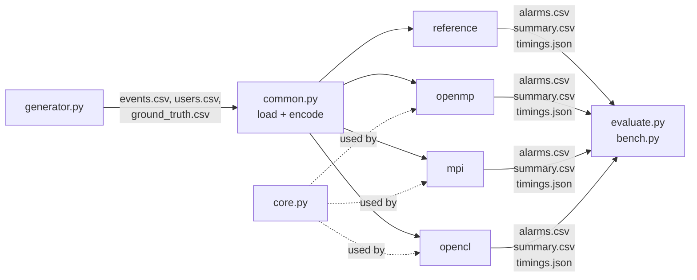
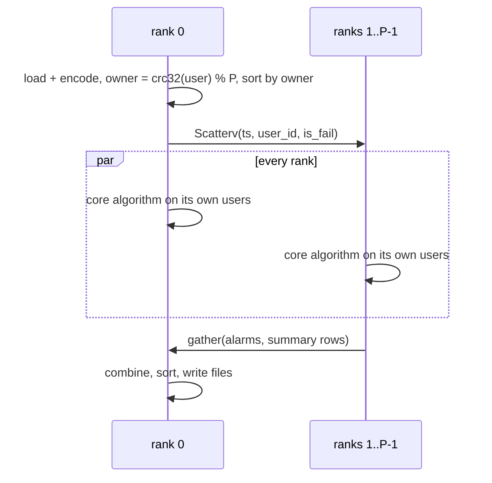

# Architecture

Topic: **Korelacja zdarzeń logowania w logach** (correlation of login events in logs).
The program finds many failed logins for one account within a short time, using a
time window and an explicit rule. There is one simple plain-Python version, which defines
the correct answer, and three parallel versions: OpenMP, MPI and OpenCL. All are in Python.

Contents:
1. Requirements → where they are met
2. The rule (exact definition)
3. Tools and why
4. Project structure
5. Data formats
6. Core algorithm
7. Backends
8. Evaluation
9. Key concepts

---

## 1. Requirements → where they are met

Each requirement from `Opis_Tematu.docx` is listed with the place in the code that meets it.

| Requirement (topic description) | Where | Milestone |
|---|---|---|
| Detect series of failed logins for one account in a short time; time windows + explicit rule | the rule (§2), all backends | M0–M5 |
| Input: time, user, source address, result | `events.csv`, `common.load_dataset` | M0 ✅ |
| Parameters: window length, threshold | `--window`, `--threshold` | M0 ✅ |
| Output: alarms with a time range + per-account summary | `alarms.csv`, `summary.csv` | M0 ✅ |
| Generator puts **labelled** attacks into normal traffic | `generator.py` → `ground_truth.csv` | M1 ✅ |
| Large data (millions of events) | NumPy arrays + compiled/parallel code; tested up to 10 M events | M2–M7 |
| Correct at the edges of **windows** | half-open window (§2.2), edge-case tests | M0 ✅ |
| Correct at the edges of **data chunks** | binary-search design (§6); OpenMP time split with halo (§7.1); test with an attack cut by a chunk border | M2–M3 |
| **OpenMP**: split accounts **or** groups of ordered events between threads | `backends/openmp.py`: `--split users` and `--split time` | M3 |
| OpenMP: with a time split, give access to the events needed by windows at the edge | halo = the previous W s read from shared memory (§7.1) | M3 |
| **MPI**: split by rule key (account); every alarm has one owner | `backends/mpi.py`, `owner = crc32(user) % P` | M4 |
| **OpenCL**: encode text, then filter, sort and count on the GPU; show encoding cost separately | `backends/opencl.py`, timed per phase | M5 |
| Report: events exactly on the window edge, empty accounts, repeated timestamps | tests in `tests/test_rule.py` + generator scenarios (§8.1) | M0 ✅, M1 |
| Report: precision, recall, events/s, time-to-alarm in a replayed stream | `evaluate.py`, `bench.py` | M2, M6, M7 |
| One rule, one kind of key | rule = brute force, key = `user` | — |

The task gives a choice for both OpenMP ("accounts **or** groups of ordered events") and MPI
("by key **or** time chunks with overlap"). The choices made:
* **OpenMP: both variants.** Splitting by account is the simple one. The time split with a
  halo is cheap to add in shared memory, and it is the part that shows correctness at the
  edges of data chunks, which is the computational goal of the task.
* **MPI: by account only.** It is simpler, and every alarm has exactly one owner by design.
  The time-chunk variant would need extra messages to join alarms that cross chunk borders.
  It is documented as an optional extra (§7.2).

---

## 2. The rule (exact definition)

All backends must give **exactly** these results. `backends/reference.py` implements this
section directly, and the tests in `tests/test_rule.py` check every edge case.

### 2.1 Input event
| Field | Type | Example |
|---|---|---|
| `ts` | integer, Unix time in **seconds** | `1767225600` |
| `user` | text | `user00042` |
| `src_ip` | text | `10.0.3.17` |
| `result` | `SUCCESS` / `FAIL` | `FAIL` |

Each event also has a `seq`, its line number in the file. `seq` is used only to order
events that have the same `ts`. Timestamps have 1-second resolution, like real auth logs,
so repeated timestamps are common.

### 2.2 Window and trigger
Parameters: **W** = window length in seconds (default 60), **N** = threshold (default 5).

For one user, sort the **FAIL** events by `(ts, seq)`: `f_0, f_1, …`.
SUCCESS events are ignored by the rule; they only appear in the summary.
The window of failure `f_i` is the half-open interval **`(ts_i − W, ts_i]`**:

```
j_i     = first index with ts_j > ts_i − W
count_i = i − j_i + 1
f_i is a TRIGGER  if  count_i ≥ N
```

| Edge case | Result |
|---|---|
| a failure exactly `W` s before (`ts = ts_i − W`) | **outside** the window |
| a failure `W − 1` s before | inside |
| N failures with the **same** timestamp | alarm (the N-th one in file order triggers) |
| N failures from `t` to `t + W` | no alarm |
| N failures from `t` to `t + W − 1` | alarm |
| account without events or with only successes ("empty account") | no alarm, still in the summary with zeros |
| event with an **empty user field** | counted as its own account named `<empty>`, not dropped |
| N = 1 | every failure triggers |

### 2.3 Alarm (merging triggers)
If every trigger became its own alarm, an attack of 100 failures would make about 96 alarms.
Instead, triggers are merged. Walk a user's triggers in order: if trigger `f_i`'s window
start `j_i` is ≤ the last index of the open alarm, the trigger **extends** that alarm;
otherwise it **opens a new one**.

| Alarm field | Meaning |
|---|---|
| `user` | account |
| `start_ts` | first failure of the first triggering window |
| `end_ts` | last trigger |
| `trigger_ts` | first trigger, i.e. the moment a live system would raise the alarm |
| `n_failures` | failures from `start_ts` to `end_ts` |
| `alarm_id` | `"user:start_ts"`, the same in every backend |

### 2.4 Per-account summary
There is one row per account in `users.csv`, plus any account that appears in the events:
`n_events`, `n_fail`, `n_success`, `first_ts`, `last_ts`, `max_window_count`, `n_alarms`.
Alarms are sorted by `(user, start_ts)` and the summary by `user`, so the result files of
different backends can be compared **byte for byte**.

---

## 3. Tools and why

| Part | Tool | Why |
|---|---|---|
| OpenMP | **Numba** `@njit(parallel=True)` + `prange`, threading layer `omp` | Numba compiles Python to machine code and runs `prange` loops on a real OpenMP runtime. Plain Python threads can't speed up computation because of the GIL (§9). |
| MPI | **mpi4py** + **Microsoft MPI** | MS-MPI is the official MPI for Windows, and mpi4py has ready Windows wheels. |
| GPU | **PyOpenCL** | The laptop has an Intel Iris Xe GPU, so CUDA (NVIDIA only) is not possible. PyOpenCL has a ready radix sort, scan and filter. |
| Data | NumPy, pandas | Columns of numbers are what all three backends need. |
| Charts | matplotlib | PNG charts for the report and slides. |
| Tests | pytest | edge cases + "every backend = reference" |

Everything runs natively on Windows 11. Fallback for MPI: WSL2 with Ubuntu + OpenMPI (same code).

---

## 4. Project structure

```
PRIR_Project/
├── README.md                  setup and configuration
├── pyproject.toml             makes src/ installable (pip install -e .) + pytest settings
├── requirements.txt           Python packages
├── demo.ps1                   runs everything for the presentation
│
├── docs/                      documentation
│   ├── ARCHITECTURE.md        this file
│   ├── ROADMAP.md             plan, milestones, report outline
│   ├── DEMO.md                step-by-step demonstration guide
│   └── Opis_Tematu.docx       topic description
│
├── config/
│   └── default.toml           rule (W, N), generator and benchmark settings
│
├── data/
│   ├── sample/                tiny hand-written dataset (in git)
│   └── <generated>/           made by `generate` (not in git)
│
├── src/login_correlation/     the program  (run: python -m login_correlation <command>)
│   ├── __main__.py            command line
│   ├── common.py              settings, data model, CSV input/output, timer
│   ├── generator.py           synthetic data with labelled attacks
│   ├── core.py                fast shared algorithm (Numba)
│   ├── evaluate.py            precision/recall + stream replay
│   ├── bench.py               benchmarks + charts
│   ├── check_env.py           checks that OpenMP, MPI and OpenCL work
│   └── backends/              the four versions of the detector
│       ├── reference.py       plain Python = the correct answer
│       ├── openmp.py          OpenMP (Numba prange)
│       ├── mpi.py             MPI (mpi4py)
│       └── opencl.py          OpenCL (PyOpenCL, GPU)
│
├── tests/
│   ├── test_rule.py           edge cases of the rule
│   ├── test_cli.py            command line + config on data/sample
│   ├── test_generator.py      generator: format, repeatability, scenarios behave as labelled
│   └── test_backends.py       every backend = reference (incl. MPI via mpiexec)
│
└── results/                   outputs of runs (created automatically, not in git)
```

**Name:** `login_correlation` comes from the topic, *Korelacja zdarzeń logowania*
("correlation of login events"). It is the name of the Python package, so you run the
program with `python -m login_correlation …`.



Every backend has the same function, so the command line and tests can use any of them:
```python
detect(events: EventArrays, params: RuleParams, **options) -> DetectionResult(alarms, summary, timings)
```

---

## 5. Data formats

Files in `data/<name>/`:
* `events.csv`: `ts,user,src_ip,result`
* `users.csv`: `user`, the list of all accounts, including some with no events
* `ground_truth.csv`: `scenario_id,type,user,start_ts,end_ts,n_events,expected_alarm`. Only `evaluate` reads it; the detector never does.

Files in `results/<run>/`:
* `alarms.csv`: `alarm_id,user,start_ts,end_ts,trigger_ts,n_failures`
* `summary.csv`: `user,n_events,n_fail,n_success,first_ts,last_ts,max_window_count,n_alarms`
* `timings.json`: time per phase (§8.3)

In memory, `EventArrays` stores the events as columns of numbers. Text is replaced by
numbers ("dictionary encoding"): `user_id` (int32), `ip_id` (int32), `is_fail` (uint8),
`ts` (int64), plus the `users` list that maps ids back to names.
The GPU part of the task requires this encoding, and Numba and MPI also work best with numbers.

---

## 6. Core algorithm

1. **Filter**: keep only the failures.
2. **Sort** by `(user_id, ts)`, using a stable sort so that equal timestamps keep file order.
3. **Count**: for each failure i, find `j_i` with a **binary search** (`lower_bound`) inside
   its user's segment; then `count_i = i − j_i + 1`.
4. **Trigger**: `count_i ≥ N`.
5. **Merge** triggers into alarms (§2.3). This is sequential per user, but users are independent.
6. **Summary**: per-user counts.

**Why a binary search and not a running counter?** A running counter needs the previous
result, so it must run in order. With a binary search, each count depends only on the
sorted data. The work can therefore be split in **any** way (by threads, processes or
GPU work-items) and the result is always the same. This is what makes the program
correct at the edges of data chunks.

Alarm merging (step 5) runs **after** all counts are known, on data in the original order.
So an attack that is cut by a chunk border is still one alarm.

---

## 7. Backends

### 7.1 OpenMP (`backends/openmp.py`)
Both ways of splitting named in the task are implemented, chosen with `--split`.

**Variant A, `--split users` (default): accounts between threads**
* Filter and sort by (user, ts) with NumPy, then compute where each user's segment starts (`seg_offsets`).
* `prange` over users: each thread gets a group of accounts. Each user's results go to its
  own part of the output arrays, so there are **no races and no locks**.
* **Load balancing:** an attacked account has far more events than a normal one. Two easy
  fixes to try and compare: mix users by size before the loop, or use
  `numba.set_parallel_chunksize(k)` (similar to OpenMP `schedule(dynamic,k)`).

**Variant B, `--split time`: groups of time-ordered events, with a halo**
```
time ─────────────────────────────────────────────────────────────▶
          chunk 0          │          chunk 1           │   chunk 2
                     ┌─halo┤ thread 1 owns [t1, t2)     │
                     │ W s │ and also reads (t1−W, t1)  │
```
* Sort the failures by (ts, file order) and cut them into one chunk per thread with about
  the same number of events. A cut is moved forward until the timestamp changes, so equal
  timestamps never end up in two chunks.
* Thread k **owns** the failures with `ts ∈ [t_k, t_{k+1})`. To count their windows it also
  **reads** the halo: the failures with `ts ∈ (t_k − W, t_k)`, found with `lower_bound`.
  In shared memory the halo is just an index range, so nothing is copied.
* Only owned failures get a count written, so every count is written exactly once.
* Alarm merging then runs on all counts together (§6), so an attack cut by a chunk border
  becomes one alarm, not two.
* The test `tests/test_backends.py` puts an attack in the middle of the data, so that with
  2 or 7 threads a chunk border cuts through it. The result must equal `reference`.

**Both variants**
* `--threads 1` is the sequential baseline for speed-up. It is the same code, so the comparison is fair.
* The report compares A and B: speed, load balance, and the cost of the halo (the extra events read).

### 7.2 MPI (`mpi.py`)

* All events of a user go to one rank, so **every alarm has exactly one owner** and no
  duplicates are possible.
* `crc32` is used instead of Python's `hash()`, because `hash()` gives different values in different processes.
* The phases scatter, compute and gather are timed with `MPI.Wtime()`.
* It runs as several processes on the laptop (`mpiexec -n 4 …`). The same code would also run on a cluster.
* *Optional extra (only if there is time):* time chunks with an overlap of W s. Rank r gets
  `(T_r − W, T_{r+1})` but only reports alarms that **start** in `[T_r, T_{r+1})`, so each
  alarm still has one owner. An alarm that continues into the next chunk needs one extra
  message from rank r+1 back to rank r.

### 7.3 OpenCL (`backends/opencl.py`)
| # | Phase | Where | How |
|---|---|---|---|
| 1 | encode | CPU | text → numbers; `ts` → offset from the first event (uint32) |
| 2 | copy to GPU | | `pyopencl.array.to_device` |
| 3 | filter | GPU | `copy_if(is_fail == 1)` |
| 4 | sort | GPU | `RadixSort` on one 64-bit key `user_id << 32 \| ts` |
| 5 | count | GPU | own kernel: each work-item does the binary search |
| 6 | per-user counts | GPU | `atomic_inc` |
| 7 | copy back | | `.get()` |
| 8 | merge | CPU | `core.merge_episodes` (the output is small) |

* The combined key means a single sort replaces "sort by user, then by time". The binary
  search for `key − W + 1` can never reach another user's events.
* Each phase is timed separately, as the task asks. The Iris Xe shares RAM with the CPU,
  so copies are cheap; mention this in the report.
* Use device `0:0` (native Intel driver), not `OpenCLOn12`, which is a slower translation layer.

### 7.4 Stream replay (`evaluate.replay`)
Events are fed one by one in time order, optionally faster than real time (`--speedup`).
A per-user queue of recent failures applies the same rule. The program measures:
* **processing latency**: the time from the event's arrival until the alarm;
* **detection delay**: `trigger_ts − attack start`.

The list of alarms must be the same as in batch mode.

---

## 8. Evaluation

### 8.1 Generated scenarios
Normal traffic: a few very active users and many quiet ones, random login times, and about 3 % typos (1–2 FAILs, then SUCCESS).
Each scenario gets its own victim account, and the victim's normal traffic is removed for 2·W
before and after it, so the label is always right. Scenarios that cannot exist when N = 1
(`slow_brute`, `typo_burst`, both edge cases) are skipped in that case.

| Scenario | What it is | Should alarm? |
|---|---|---|
| `brute_force` | N…5N failures within less than W seconds from one IP | yes |
| `slow_brute` | failures spread out below the threshold rate | yes, but the rule will miss it (honestly lowers recall) |
| `typo_burst` | N−1 failures, then a success | no |
| `edge_exact_window` | N failures spanning exactly W s | no |
| `edge_inside_window` | N failures spanning W−1 s | yes |
| `same_timestamp` | N failures with the same `ts` | yes |
| `empty_username` | N failures with an empty user field | yes (account `<empty>`) |
| empty accounts | in `users.csv` with no events | summary check (zeros) |

The same `--seed` always gives the same data.

### 8.2 Metrics
* An alarm **matches** a scenario if it is the same user and the time ranges overlap.
* **Precision** = alarms that match an expected scenario / all alarms
* **Recall** = expected scenarios that were found / all expected scenarios
* Also: results per scenario type, and detection delay.

### 8.3 Timing
Every backend reports the same phases: `load`, `encode`, `prepare`, `compute`, `merge`,
`collect`, `total`. Throughput = events / (prepare + compute + merge + collect). It is
also given with `encode` included. Numba compile time is excluded (one warm-up run first).

### 8.4 Experiments
| Experiment | Changes | Fixed |
|---|---|---|
| OpenMP scaling | threads 1, 2, 4, 6, 8, 10, 12; `--split users` vs `time` | 10 M events |
| MPI scaling | processes 1, 2, 4, 6, 8 | 10 M events |
| Data size | 0.1 M, 1 M, 5 M, 10 M | best setting of each backend |
| GPU phases | — | stacked bar chart |
| Rule parameters | W ∈ {10, 60, 300}, N ∈ {3, 5, 10} | precision / recall |
| Stream | speed-up 100, 1000, ∞ | latency p50 / p95 |

Each run is repeated 5 times and the median is reported. Run on the charger in "Best
performance" mode. The i5-1235U has 2 fast P-cores and 8 slower E-cores, so the speed-up
curve flattens early; explain this in the report.

### 8.5 Correctness evidence for the report
The task asks for three edge cases to be checked. This is where the evidence for each comes from:

| Edge case | Unit test (`tests/test_rule.py`) | In generated data (§8.1) |
|---|---|---|
| event exactly on the window edge | `test_event_exactly_W_before_is_outside_window`, `…_W_minus_1_…` | `edge_exact_window`, `edge_inside_window` |
| empty accounts | `test_empty_account_is_in_summary`, `test_empty_username_is_its_own_account` | `users.csv` accounts with no events, `empty_username` |
| repeated timestamps | `test_repeated_timestamps` | `same_timestamp` + 1 s resolution everywhere |
| edge of a data chunk | `tests/test_backends.py` (attack cut by a chunk border) | — |

In addition, every parallel version must produce files **identical** to `reference`
(`python -m login_correlation compare …`).

---

## 9. Key concepts

| Concept | Short explanation |
|---|---|
| **GIL** | CPython runs only one thread of Python code at a time, so plain threads don't speed up computation. Numba-compiled code runs without the GIL. |
| **OpenMP / `prange`** | Shared memory: threads split a loop and all see the same arrays. `prange` in Numba ≈ `#pragma omp parallel for` in C. |
| **Race condition** | Two threads write the same memory at once. It is avoided here because each user's output goes to its own place. |
| **MPI** | Separate processes with no shared memory, which exchange messages (`Scatterv` splits data, `gather` collects results). |
| **Halo / overlap** | When data is split by time, a chunk also needs the last W seconds of the previous chunk to count windows correctly (OpenMP variant B). Splitting by account avoids this. |
| **GPU kernel / work-item** | A small function run by thousands of GPU threads, one per element. |
| **Filter, scan, radix sort** | Typical GPU building blocks: keep matching elements, running totals, integer sort digit by digit. |
| **Speed-up / efficiency** | S(p) = T(1)/T(p), E(p) = S(p)/p. |
| **Amdahl's law** | The sequential part (reading the CSV, sorting, merging) limits the maximum speed-up. |
| **Precision / recall** | How many alarms are real attacks / how many attacks were found. |
